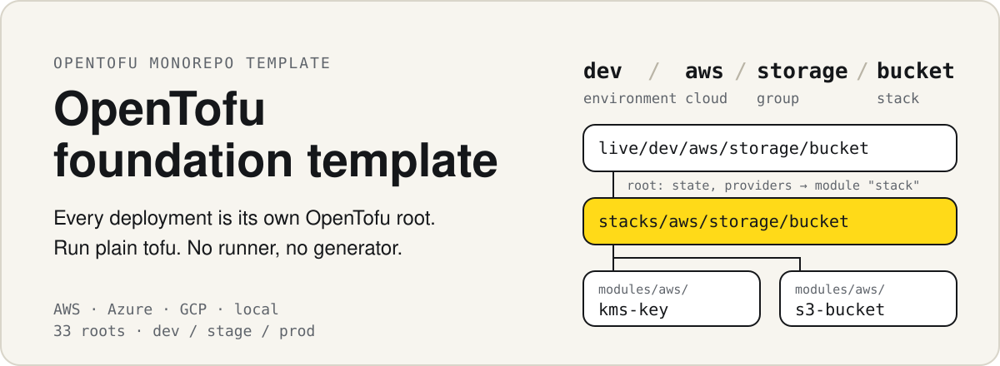
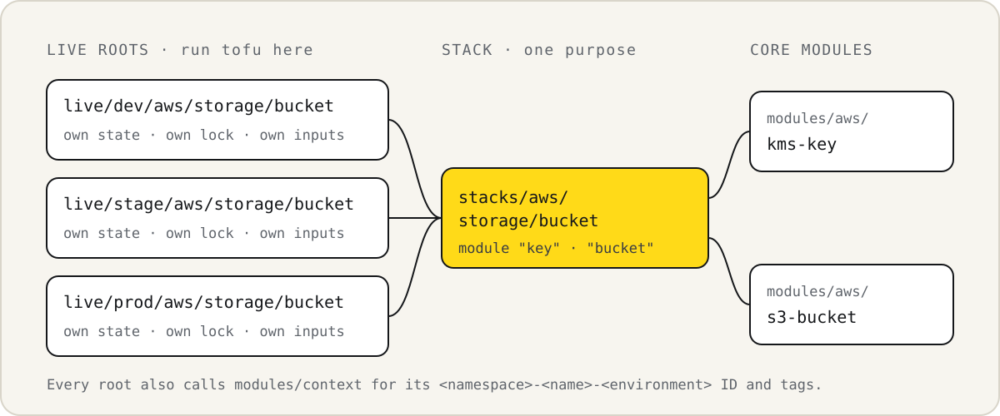
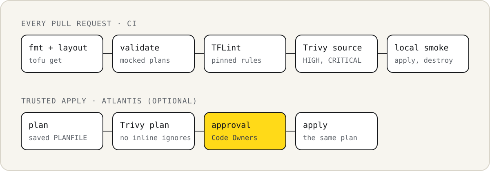

<p align="center">
  
</p>

<p align="center">
  <a href="https://github.com/ziwon/terraform-foundation-tempalte/actions/workflows/check.yml"></a>
  <a href="mise.toml"></a>
  <a href="docs/cloud-setup.md"></a>
  <a href="LICENSE"></a>
  <br>
  <a href="docs/quality.md"></a>
  <a href="docs/quality.md"></a>
  <a href=".github/workflows/check.yml"></a>
  <br>
  <a href="docs/atlantis.md"></a>
  <a href="integrations/prowler/README.md"></a>
  <a href="integrations/infracost/README.md"></a>
</p>

<p align="center">
  <a href="README.md">English</a> ·
  <a href="docs/architecture.md">구조</a> ·
  <a href="docs/cloud-setup.md">클라우드 설정</a> ·
  <a href="docs/operations.md">운영</a> ·
  <a href="docs/quality.md">품질 검사</a> ·
  <a href="docs/atlantis.md">Atlantis</a> ·
  <a href="CONTRIBUTING.md">기여 안내</a>
</p>

AWS, Azure, GCP를 위한 OpenTofu 모노레포 템플릿입니다. 배포 하나는 디렉터리
하나이고, 그 디렉터리가 backend, provider, 입력, lock 파일을 직접 가집니다. 실행은
평범한 `tofu` 명령으로 합니다. 배포에는 Python, 생성기, 저장소 전용 실행기가 필요하지 않습니다.

## 클라우드 계정 없이 실행해 보기

`mise install`로 OpenTofu 1.12.5, just, 그리고 [mise.toml](mise.toml)에 고정된 다른
도구를 설치합니다. 레시피에는 Python 3.10 이상도 필요합니다. 로컬 catalog는 내장
`terraform_data` 리소스만 사용하므로 로컬 상태만 만들고 클라우드 리소스는 만들지 않습니다.

```sh
cp .env.local.dev.example .env.local.dev
just use local.dev
just init foundation catalog
just plan foundation catalog
just apply foundation catalog
just state-list foundation catalog
```

`just use`로 로컬 컨텍스트를 고르면 각 레시피는 `<group> <stack>`만 받습니다. 레시피는
`tofu`를 실행하기 전에 사용할 stack, 루트, backend, 상태를 출력합니다.

```text
Context
  Env file    : .env.local.dev
  Environment : dev
  Cloud       : local
  Credentials : none needed
  OpenTofu    : OpenTofu v1.12.5
  Stack       : stacks/local/foundation/catalog
  Root        : live/dev/local/foundation/catalog
  Backend     : local
  State       : .infra/state/dev/local/foundation/catalog/terraform.tfstate
  TF data dir : live/dev/local/foundation/catalog/.terraform
  Identity    : local root, nothing to check

Plan: 1 to add, 0 to change, 0 to destroy.
deployment_name = "starter-catalog-dev"
module.stack.module.catalog.terraform_data.catalog
```

저장된 plan은 확인 질문 없이 적용되므로 먼저 검토하세요. catalog를 지우려면
`just destroy-plan foundation catalog`와 `just apply foundation catalog`를 실행합니다.

각 레시피는 기본 명령 하나를 실행합니다. just 없이 루트에서 같은 단계를 실행할 수 있습니다.

```sh
cd live/dev/local/foundation/catalog
tofu init -lockfile=readonly
tofu plan -out=plan.tfplan
tofu apply plan.tfplan
```

## 포함된 것

dev, stage, prod에 걸쳐 배포 루트 33개를 제공합니다.

| 클라우드 | 네트워크 | 스토리지 | 원격 상태 |
| --- | --- | --- | --- |
| AWS | VPC, private subnet, 기본 차단 security group | 비공개, 암호화, 버전 관리 S3 bucket | lock 파일을 쓰는 S3 |
| Azure | VNet, subnet, network security group | 비공개 container, 버전 관리, ID 기반 접근 | lease를 쓰는 Azure Blob |
| GCP | Custom VPC, subnet, 수신 방화벽 | uniform access를 쓰는 비공개 버전 관리 bucket | lock을 쓰는 GCS |
| 로컬 | 내장 catalog | 로컬 상태만 | 로컬 파일 |

- 클라우드마다 자체 backend 저장소를 만드는 상태 bootstrap 루트가 있고, 삭제 보호가
  걸려 있습니다. [bootstrap](docs/bootstrap.md)을 참고하세요.
- AWS에는 GitHub Actions OIDC role이 있어서, workflow가 키를 저장하지 않고 짧게
  유지되는 role을 맡습니다. [클라우드 설정](docs/cloud-setup.md#let-github-actions-assume-an-aws-role)을 참고하세요.
- 예제는 컴퓨팅, NAT gateway, 공인 IP를 만들지 않습니다. 그래도 스토리지, 요청, 키,
  버전, 로그에는 요금이 생길 수 있습니다.

## 구성 방식

<p align="center">
  
</p>

배포 주소는 `environment/cloud/group/stack` 형식이며, 예를 들면
`dev/aws/storage/bucket`입니다. 이 주소가 세 계층을 가리킵니다.

- **`live/<주소>`** 는 직접 실행하는 루트입니다. backend, provider, 입력, lock 파일을
  가지며, stack 하나를 `module "stack"`으로 호출합니다.
- **`stacks/<cloud>/<group>/<stack>`** 은 한 가지 용도에 맞게 리소스를 조합합니다.
  모든 환경이 같은 stack을 호출합니다.
- **`modules/<cloud>/<name>`** 에는 `kms-key`, `s3-bucket` 같은 재사용 구성 요소가 있습니다.
  `modules/context`는 모든 루트가 쓰는 `<namespace>-<name>-<environment>` ID와 태그를 만듭니다.

Stack과 모듈에는 provider나 backend 설정이 없습니다. 각 루트는 주소와 일치하는 상태
키를 명시합니다. [구조](docs/architecture.md), [이름과 태그](docs/context.md),
[배포 추가](docs/adding-stacks.md)를 참고하세요.

## 클라우드 배포 시작하기

1. `live/<environment>/<cloud>/<group>/<stack>` 아래에서 루트를 고릅니다.
2. `terraform.tfvars.json`에 계정, 구독, 또는 프로젝트와 리전, 이름을 설정합니다.
3. [bootstrap](docs/bootstrap.md)으로 상태 저장소를 만들거나, 이미 관리 중인 저장소를 씁니다.
4. `backend.tf`의 저장소 자리표시자를 바꿉니다. 명시된 key나 prefix는 유지합니다.
5. 클라우드의 ID 방식으로 로그인합니다. [클라우드 설정](docs/cloud-setup.md)을 참고하세요.
6. 클라우드에 맞는 컨텍스트 예시를 복사하고, CLI 자격 증명을 설정한 뒤 선택합니다.
7. 저장된 plan을 검토한 뒤 승인된 절차로 적용합니다.

```sh
cp .env.aws.dev.example .env.aws.dev   # AWS_PROFILE을 설정합니다
just use aws.dev
just init network core
just plan network core
just apply network core
```

자격 증명을 쓰는 레시피는 `tofu`를 실행하기 전에 로그인한 ID가 루트와 맞는지도
확인합니다. 계정, 리전, 구독, 프로젝트가 다르면 멈춥니다.

```text
Context
  Env file    : .env.aws.dev
  Environment : dev
  Cloud       : aws
  Credentials : AWS_PROFILE=sandbox, AWS_REGION=us-east-1
  OpenTofu    : OpenTofu v1.12.5
  Stack       : stacks/aws/network/core
  Root        : live/dev/aws/network/core
  Backend     : s3 (bucket example-tfstate, region us-east-1)
  State       : dev/aws/network/core/terraform.tfstate
  TF data dir : live/dev/aws/network/core/.terraform
  Identity    : matches AWS account 111111111111, AWS region us-east-1 as arn:aws:iam::111111111111:user/operator
```

계정, 리전, 상태 버킷은 컨텍스트가 아니라 루트의 파일에서 옵니다. 레시피는
`dev/aws/network/core` 같은 전체 경로도 받습니다. 전체 레시피는 `just --list`로 볼 수
있고, 자세한 내용은 [운영](docs/operations.md#select-a-context)을 참고하세요.

### just 없이 실행하기

```sh
python3 tools/preflight.py dev/aws/network/core   # 선택: 로그인 확인
tofu -chdir=live/dev/aws/network/core init -lockfile=readonly
tofu -chdir=live/dev/aws/network/core plan -out=plan.tfplan
tofu -chdir=live/dev/aws/network/core apply plan.tfplan
```

## 검사

<p align="center">
  
</p>

Python 3.10 이상과 `mise.toml`의 도구가 있으면 같은 검사를 로컬에서 실행할 수 있습니다.

```sh
python3 tools/check.py
python3 tools/smoke.py
python3 tools/quality_smoke.py
gitleaks dir . --redact --no-banner
```

[CI](.github/workflows/check.yml)는 전체 기록에 대해 Gitleaks도 실행합니다. 클라우드
테스트는 plan만 하며 mock이나 가짜 자격 증명을 씁니다. 로컬 기본 명령은 스캔이나 승인을
실행하지 않습니다. 신뢰된 자동화가 소스와 저장된 plan을 스캔하고 승인을 요구해야 합니다.
Trivy는 설정을 검사하지만 IAM role이 무엇을 할 수 있는지는 판단하지 않으므로, role 권한은
PR에서 직접 검토하세요. [품질 검사](docs/quality.md)와 [검증 범위](docs/verification.md)를 참고하세요.

## 선택형 통합

모두 필수가 아닙니다. 일반 `tofu` 명령은 이것들 없이 동작합니다.

| 통합 | 추가되는 것 | 상태 |
| --- | --- | --- |
| [Atlantis](docs/atlantis.md) | 소스와 저장된 plan 스캔, Code Owner 승인을 거치는 PR plan과 apply | 서버 설정을 로컬에서 검증함 |
| [GitHub Actions OIDC](docs/cloud-setup.md#let-github-actions-assume-an-aws-role) | 정확한 저장소, 브랜치, 환경 claim만 신뢰하는 AWS role | 실제 계정에서 아직 실행하지 않음 |
| [Prowler](integrations/prowler/README.md) | 선택형 읽기 전용 감사 role과 정기 계정 스캔 workflow | 실제 계정에서 아직 실행하지 않음 |
| [Infracost](integrations/infracost/README.md) | 저장된 plan의 비용을 계산하는 `just cost <group> <stack>` | API 키가 필요하며 여기서는 실행하지 않음 |
| [Preflight](docs/operations.md) | 클라우드 로그인과 루트를 비교하는 `just preflight <group> <stack>` | 가짜 CLI로 검증함 |

## 보안과 상태

상태, 저장된 plan, provider 메타데이터, 보고서에는 비밀값이 들어갈 수 있습니다. Git과
공개 로그에 남기지 마세요. 로컬 상태와 bootstrap 상태는 `.infra/state/`에 있으므로,
`.infra/`를 지우면 그 상태도 지워집니다. 배포를 켜거나 fork를 공개하기 전에
[보안](SECURITY.md)과 [공개 전 점검표](docs/publishing.md)를 읽으세요.

## 라이선스

[MIT](LICENSE). 설치한 provider와 도구는 각자의 라이선스를 따릅니다.
