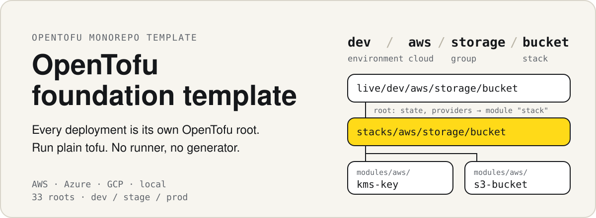
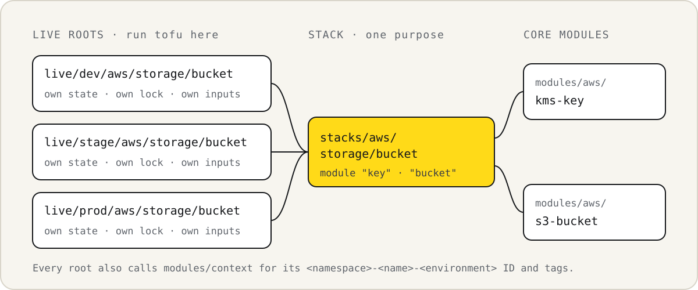
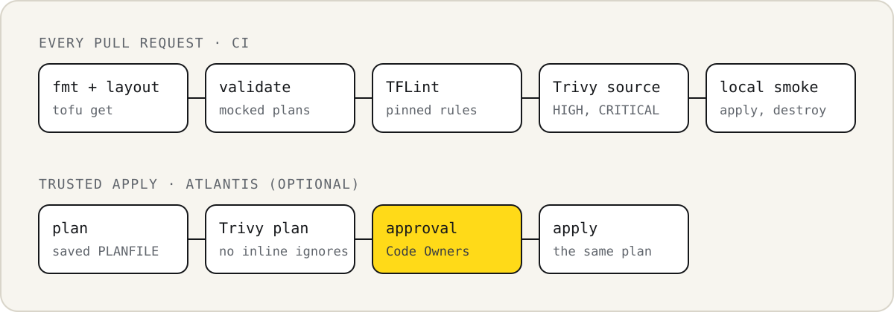

<p align="center">
  
</p>

<p align="center">
  <a href="https://github.com/ziwon/terraform-foundation-tempalte/actions/workflows/check.yml"></a>
  <a href="mise.toml"></a>
  <a href="docs/cloud-setup.md"></a>
  <a href="LICENSE"></a>
  <br>
  <a href="docs/quality.md"></a>
  <a href="docs/quality.md"></a>
  <a href=".github/workflows/check.yml"></a>
  <br>
  <a href="docs/atlantis.md"></a>
  <a href="integrations/prowler/README.md"></a>
  <a href="integrations/infracost/README.md"></a>
</p>

<p align="center">
  <a href="README.ko.md">한국어</a> ·
  <a href="docs/architecture.md">Architecture</a> ·
  <a href="docs/cloud-setup.md">Cloud setup</a> ·
  <a href="docs/operations.md">Operations</a> ·
  <a href="docs/quality.md">Quality checks</a> ·
  <a href="docs/atlantis.md">Atlantis</a> ·
  <a href="CONTRIBUTING.md">Contributing</a>
</p>

An OpenTofu monorepo template for AWS, Azure, and GCP. Each deployment is one
directory with its own backend, providers, inputs, and lock file, and you run it with
plain `tofu`. Deployments need no Python, generator, or repository runner.

## Try it without a cloud account

Run `mise install` to get OpenTofu 1.12.5, just, and the other tools pinned in
[mise.toml](mise.toml). The recipes also need Python 3.10 or later. The local catalog
uses only the built-in `terraform_data` resource, so it creates local state and no
cloud resources.

```sh
cp .env.local.dev.example .env.local.dev
just use local.dev
just init foundation catalog
just plan foundation catalog
just apply foundation catalog
just state-list foundation catalog
```

`just use` selects the local context, so each recipe takes `<group> <stack>`. Before
it runs `tofu`, a recipe prints the stack, root, backend, and state it will use:

```text
Context
  Env file    : .env.local.dev
  Environment : dev
  Cloud       : local
  Credentials : none needed
  OpenTofu    : OpenTofu v1.12.5
  Stack       : stacks/local/foundation/catalog
  Root        : live/dev/local/foundation/catalog
  Backend     : local
  State       : .infra/state/dev/local/foundation/catalog/terraform.tfstate
  TF data dir : live/dev/local/foundation/catalog/.terraform
  Identity    : local root, nothing to check

Plan: 1 to add, 0 to change, 0 to destroy.
deployment_name = "starter-catalog-dev"
module.stack.module.catalog.terraform_data.catalog
```

A saved plan applies without a prompt, so review it first. Remove the catalog with
`just destroy-plan foundation catalog` and `just apply foundation catalog`.

Each recipe runs one native command. Without just, run the same steps from the root:

```sh
cd live/dev/local/foundation/catalog
tofu init -lockfile=readonly
tofu plan -out=plan.tfplan
tofu apply plan.tfplan
```

## What you get

33 deployment roots for dev, stage, and prod.

| Cloud | Network | Storage | Remote state |
| --- | --- | --- | --- |
| AWS | VPC, private subnet, default-deny security group | Private, encrypted, versioned S3 bucket | S3 with lock files |
| Azure | VNet, subnet, network security group | Private containers, versioning, identity-based access | Azure Blob with leases |
| GCP | Custom VPC, subnet, ingress firewall | Private, versioned bucket with uniform access | GCS with locking |
| Local | Built-in catalog | Local state only | Local file |

- Each cloud has a state bootstrap root that creates its own backend storage, with
  deletion protection. See [bootstrap](docs/bootstrap.md).
- AWS has GitHub Actions OIDC roles, so workflows assume short-lived roles instead
  of storing keys. See [cloud setup](docs/cloud-setup.md#let-github-actions-assume-an-aws-role).
- The examples create no compute, NAT gateways, or public IPs. Storage, requests,
  keys, versions, and logs can still incur charges.

## How it fits together

<p align="center">
  
</p>

A deployment address is `environment/cloud/group/stack`, such as
`dev/aws/storage/bucket`. The address names three layers:

- **`live/<address>`** is the root you run. It owns the backend, providers, inputs,
  and lock file, and calls one stack as `module "stack"`.
- **`stacks/<cloud>/<group>/<stack>`** composes resources for one purpose. Every
  environment calls the same stack.
- **`modules/<cloud>/<name>`** holds reusable building blocks, such as `kms-key` and
  `s3-bucket`. `modules/context` builds the `<namespace>-<name>-<environment>` ID
  and tags that every root uses.

Stacks and modules configure no providers or backends. Each root keeps an explicit
state key that matches its address. See [architecture](docs/architecture.md),
[names and tags](docs/context.md), and [adding deployments](docs/adding-stacks.md).

## Start a cloud deployment

1. Pick a root under `live/<environment>/<cloud>/<group>/<stack>`.
2. Set its account, subscription, or project, region, and names in `terraform.tfvars.json`.
3. Create state storage with [bootstrap](docs/bootstrap.md), or use storage you already manage.
4. Replace the storage placeholders in `backend.tf`. Keep its explicit key or prefix.
5. Log in through your cloud's identity mechanism. See [cloud setup](docs/cloud-setup.md).
6. Copy the context example for the cloud, set its CLI credentials, and select it.
7. Review a saved plan, then apply it through your approved process.

```sh
cp .env.aws.dev.example .env.aws.dev   # set AWS_PROFILE
just use aws.dev
just init network core
just plan network core
just apply network core
```

Recipes that use credentials also check your login against the root before `tofu`
runs. They stop on a wrong account, region, subscription, or project:

```text
Context
  Env file    : .env.aws.dev
  Environment : dev
  Cloud       : aws
  Credentials : AWS_PROFILE=sandbox, AWS_REGION=us-east-1
  OpenTofu    : OpenTofu v1.12.5
  Stack       : stacks/aws/network/core
  Root        : live/dev/aws/network/core
  Backend     : s3 (bucket example-tfstate, region us-east-1)
  State       : dev/aws/network/core/terraform.tfstate
  TF data dir : live/dev/aws/network/core/.terraform
  Identity    : matches AWS account 111111111111, AWS region us-east-1 as arn:aws:iam::111111111111:user/operator
```

The account, region, and state bucket come from the root's files, not the context.
Recipes also accept the full `dev/aws/network/core` path. Run `just --list` for every
recipe, and see [operations](docs/operations.md#select-a-context).

### Without just

```sh
python3 tools/preflight.py dev/aws/network/core   # optional login check
tofu -chdir=live/dev/aws/network/core init -lockfile=readonly
tofu -chdir=live/dev/aws/network/core plan -out=plan.tfplan
tofu -chdir=live/dev/aws/network/core apply plan.tfplan
```

## Checks

<p align="center">
  
</p>

Run the same checks locally with Python 3.10 or later and the tools from `mise.toml`:

```sh
python3 tools/check.py
python3 tools/smoke.py
python3 tools/quality_smoke.py
gitleaks dir . --redact --no-banner
```

[CI](.github/workflows/check.yml) also runs Gitleaks on the full history. Cloud tests
are plan-only and use mocks or fake credentials. Native local commands run no scans or
approvals. Trusted automation must run the source and saved-plan scans and require
approval. Trivy checks configuration, not what an IAM role may do, so review role
permissions in the pull request. See [quality checks](docs/quality.md) and
[verification](docs/verification.md).

## Optional integrations

None of these is required. Ordinary `tofu` commands work without them.

| Integration | What it adds | Status |
| --- | --- | --- |
| [Atlantis](docs/atlantis.md) | Pull request plans and applies with source and saved-plan scans and Code Owner approval | Server config tested locally |
| [GitHub Actions OIDC](docs/cloud-setup.md#let-github-actions-assume-an-aws-role) | AWS roles that trust exact repository, branch, or environment claims | Not yet run against a live account |
| [Prowler](integrations/prowler/README.md) | Opt-in read-only audit role and a scheduled account scan workflow | Not yet run against a live account |
| [Infracost](integrations/infracost/README.md) | `just cost <group> <stack>` prices a saved plan | Needs an API key; not run here |
| [Preflight](docs/operations.md) | `just preflight <group> <stack>` compares your cloud login with a root | Tested with fake CLIs |

## Security and state

State, saved plans, provider metadata, and reports can contain secrets. Keep them out
of Git and public logs. Local and bootstrap state live under `.infra/state/`, so
deleting `.infra/` deletes that state. Read [security](SECURITY.md) and the
[publication checklist](docs/publishing.md) before you enable deployments or publish a fork.

## License

[MIT](LICENSE). Installed providers and tools keep their own licenses.
