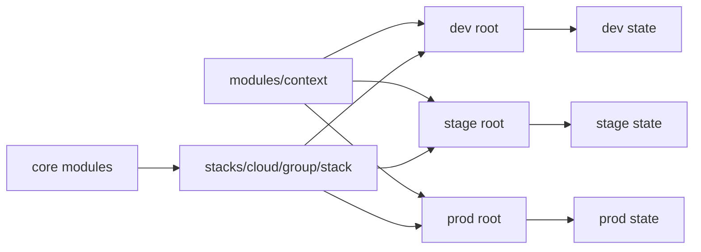

# Architecture

## A deployment is an executable root

`live/<environment>/<cloud>/<group>/<stack>` contains everything OpenTofu needs to
select a deployment. Each root has its own backend, provider configuration, inputs,
outputs, and provider lock. Run `tofu` in that directory or use `tofu -chdir=...`.
There is no active-environment file or runtime generator.

## Roots call stacks, and stacks call core modules

The repository has three layers.

- `live/<environment>/<cloud>/<group>/<stack>` holds the executable roots. A root
  owns its backend, providers, inputs, outputs, and lock, and calls one stack
  through `module "stack"`.
- `stacks/<cloud>/<group>/<stack>` holds purpose-specific compositions. A stack
  declares the resources for one kind of deployment and may call core modules as
  nested modules. The 30 roots call ten stacks.
- `modules/` holds reusable core building blocks and the shared `modules/context`
  naming convention.

Stacks and core modules declare required providers but do not configure providers
or backends. A stack accepts only consumed resource inputs plus a typed `context`
object with `id` and `tags`. Besides `modules/context`, `modules/` holds core
modules under `modules/local`, `modules/aws`, `modules/azure`, and `modules/gcp`.
Every supplied stack calls at least one of them.

The stack layer separates purpose from implementation. A state-bucket stack and a
data-bucket stack can call one bucket module with different settings. A fix to that
module then reaches both stacks without an edit to either root.

The `stacks/` directory holds no executable roots, backends, or state. Run `tofu`
only in a `live/` root.

## Shared names and tags

Each root's `context.tf` calls `modules/context`. `module.context.id` supplies the
`<namespace>-<name>-<environment>` name. `module.context.tags` combines reserved
metadata with optional live-input tags. Providers use those outputs directly, and
resources receive them through the stack's `context` input.

Cloud-specific name rules live in the core module that owns the resource.
`modules/aws/s3-bucket` and `modules/gcp/storage-bucket` add the account or project
suffix, and `modules/azure/storage-account` applies the Azure account character
limits. Adding
tags does not change names. See [names and tags](context.md).

## Explicit state locations

| Backend | Configured state location |
| --- | --- |
| Local | Repository `.infra/state/<deployment>/terraform.tfstate` |
| S3 | Object key `<deployment>/terraform.tfstate` |
| Azure Blob | Blob key `<deployment>/terraform.tfstate` |
| GCS | Prefix `<deployment>` with the default-workspace object `default.tfstate` |

Each root commits its non-secret backend settings in `backend.tf`. Local paths
are relative to the root and resolve into the repository's `.infra/state/` tree.
Credentials come from the backend's native authentication mechanism.
S3 uses lock files, Azure uses Blob leases, and GCS uses native state locking.
Initialization connects to existing storage. [Bootstrap roots](bootstrap.md)
provision storage separately and retain independent local state.

Backend identity and resource address are separate concerns. Moving a resource
into another module changes its address but not its backend location. Add a `moved`
block when you move a resource that already exists in state.

## Native operations and automation policy

Each root has its own `.terraform/` working directory. Saved plans belong to the
chosen root or the automation system's plan path. Ordinary native commands need
no Python process or generated backend file.
Use the default workspace and avoid hidden variable or CLI overrides when applying
reviewed deployment values. Native OpenTofu accepts its standard flags and environment variables.

A native saved-plan apply checks state compatibility
but does not prove that the current checkout is unchanged or that a human approved
that artifact. Operators must review plans and regenerate them after source or policy changes.

Trusted deployment automation owns mandatory scans, approvals, plan retention,
and deployment concurrency. [Atlantis](atlantis.md) uses built-in init, plan, and
apply so one native workflow owns its `PLANFILE`. Quality steps scan source and
that saved plan. Server-owned configuration retains approval requirements.

## Boundaries

Each root is independently planned and applied. There is no implicit global
ordering or automatic cross-deployment apply. Pass reviewed values or provider
interfaces between deployments rather than broad access to another deployment's state.

Environment paths and state prefixes do not create IAM isolation. Use separate
accounts, subscriptions, projects, storage, and identities for separate trust boundaries.
Explicit environment names such as `prod-eu` and `prod-us` can represent multiple targets.

Optional Python tools discover roots for CI, generate Atlantis examples, and inspect
scanner reports. They do not select or drive ordinary deployment operations.
Cloud tests remain plan-only. Live recovery, drift detection, and organization-specific
policy require adopter verification.
