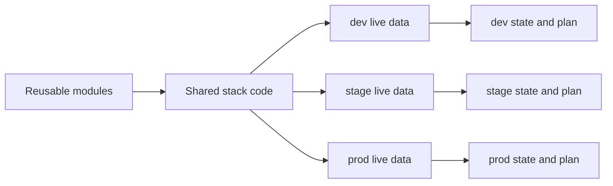

# Architecture

## Deployment as the unit of change

`environment/cloud/group/stack` identifies one deployment. It determines an
executable root, live input files, backend state address, command lock, working
data directory, and saved plan. Code has no active environment.

Modules have typed inputs and outputs, and no provider configuration or backend.
Stacks configure providers, compose resources/modules, and own provider versions
and lock files. Live directories contain JSON data only. A partial backend is
declared in the native Terraform JSON syntax in `backend.tf.json`; it contains
the backend type but no environment values.

The runner discovers deployments from `live/**/terraform.tfvars.json`. There is
no separate hand-maintained inventory to update when adding an environment.
The same inventory feeds local checks and CI.

## Shared names and tags

Every stack's `context.tf` calls `modules/context`. Its `id` output supplies the
canonical `<namespace>-<name>-<environment>` name, and `tags` combines reserved
deployment metadata with optional live-input tags. Resources and providers consume
`module.context.id` and `module.context.tags` directly. The module creates no
resources and requires no external provider or registry dependency.

Cloud-specific naming transformations stay in each stack, including Azure storage
account character restrictions and account/project suffixes for storage names.
Additional tags do not alter names. See [names and tags](context.md) for the shared
tag constraints and resource-specific `Name` examples.

## Native state backends

| Backend | Derived state location |
| --- | --- |
| local | `.infra/state/<deployment>/terraform.tfstate` |
| S3 | object key `<deployment>/terraform.tfstate` |
| Azure Blob | blob key `<deployment>/terraform.tfstate` |
| GCS | prefix `<deployment>`; default-workspace object `default.tfstate` |

Native backends provide remote locking. S3 uses `use_lockfile = true`; Azure
uses Blob leases; GCS supports state locking. Bucket/container identity is
non-secret live data. Credentials come from the cloud's identity mechanism.
Initialization never creates a bucket or container.
Explicit bootstrap stacks create that storage using independent local state and
export backend JSON for workloads. They use the same deployment boundaries and
require the `bootstrap` command; see [bootstrap](bootstrap.md).

Code/state separation is not an IAM boundary. Separate accounts, subscriptions,
projects, state storage, and credentials where trust boundaries require it.
This template models one target per cloud/environment. For multiple targets,
use explicit environment names such as `prod-eu` and `prod-us`, or separate
repositories for separate trust boundaries.

## Local isolation and concurrency

The runner sets `TF_DATA_DIR` to `.infra/<engine>/<deployment>/data`.
Backend-less validation and mock tests use a different `check-data` directory,
so they cannot replace a deployment's initialized backend.

A process lock prevents concurrent commands for the same deployment, including
across engines. Different deployments can run concurrently. Provider installation
and TFLint plugin installation take separate shared cache locks because installers write shared files. Plans
and remote operations remain independent. Provider locks are only writable
through the explicit `lock` command; ordinary initialization uses readonly locks.

Only the default workspace is supported. Nonempty `TF_CLI_ARGS*` and `TF_VAR_*`
are rejected so hidden flags or inputs cannot change the selected deployment.
Use explicit live data and standard provider authentication variables instead.
Paths must use four lowercase slug segments; symlinks and traversal are rejected.

## Saved-plan lifecycle

1. `init` records the selected backend identity.
2. `plan` removes previous plan artifacts, runs the engine, and saves a receipt
   only when planning and the saved-plan security scan succeed and the source has remained stable.
3. The receipt binds the plan checksum to the deployment, engine version,
   live input/backend data, stack source, provider lock, local module source, and quality-tool policy.
4. `apply` verifies that binding, asks for the deployment's full name, rescans the
   actual plan, and verifies the binding again before invoking the engine.
5. After an apply attempt, the saved plan is discarded. Inspect the result and
   generate a fresh plan before retrying.

The receipt detects accidental stale or swapped plans; it is not a cryptographic
approval system against an attacker with write access to the checkout. Local
files use a restrictive umask and remain under ignored `.infra/`.

Stack-owned tests and documentation are not executable infrastructure inputs and
do not invalidate plans. All local module source is included conservatively;
this avoids a fragile custom HCL dependency parser. If the repository becomes
large, replace this with a tested module dependency graph.

## Deliberate boundaries

- Each stack is independently planned and applied. There is no implicit global
  dependency order or automatic cross-stack apply.
- Pass explicit outputs through reviewed deployment data or a provider's public
  interface (for example a parameter store). Avoid granting broad access to
  another stack's entire state just to obtain an identifier.
- The examples use standard HCL and native backend behavior. No Terragrunt,
  custom provider, or code-generation runtime is required to execute a stack.
- CI checks code, lint rules, source security, mocked plans, and scanner rejection
  fixtures. Live cloud tests, drift detection, organization-specific policies, and
  deployment approval are additions for adopters.

References: [S3 backend](https://developer.hashicorp.com/terraform/language/backend/s3),
[Azure backend](https://developer.hashicorp.com/terraform/language/backend/azurerm),
[GCS backend](https://developer.hashicorp.com/terraform/language/backend/gcs),
[OpenTofu provider locks](https://opentofu.org/docs/language/files/dependency-lock/).
